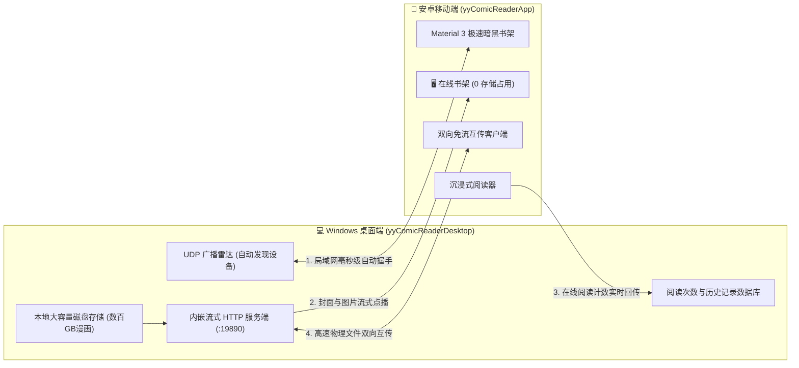

# 📖 YY漫画阅读器 桌面版 (yyComicReader Desktop)

<p align="center">
  
</p>

<p align="center">
  <b>极速、优雅、现代化的本地离线漫画阅读中枢 & 跨端流式共享服务器</b><br>
  <sub>基于 .NET 10 (C# 13) + Microsoft Edge WebView2 (Chromium) 混合架构构建，支持连续瀑布流长卷阅读、局域网双向极速互传、手机端免下载在线书架与双端阅读状态实时互通。</sub>
</p>

<p align="center">
  
  
  
  
  
  <a href="https://github.com/yamada17kawa-lab/yyComicReaderDesktop/releases/latest"></a>
  
</p>

<p align="center">
  <a href="https://github.com/yamada17kawa-lab/yyComicReaderDesktop/releases/latest">
    
  </a>
  &nbsp;&nbsp;
  <a href="https://github.com/yamada17kawa-lab/yyComicReaderApp">
    
  </a>
</p>

---

> [!TIP]
> **🚀 配合安卓手机端，畅享双端联动生态！**
> 本项目与配套安卓客户端 **[yyComicReaderApp (YY漫画阅读器 安卓版)](https://github.com/yamada17kawa-lab/yyComicReaderApp)** 深度配合。
> 只要电脑与手机连入同一 Wi-Fi：
> 1. **双向秒级互传**：无需数据线，大批漫画千兆 Wi-Fi 极速无线传输，自动跳过已有漫画。
> 2. **手机在线免下载看漫画**：手机端直接化身无线终端，在线读取电脑端海量漫画切片与封面，**手机本地零占用磁盘空间**！
> 3. **阅读数据实时同步**：手机在床上看漫画，电脑端的阅读次数与时间戳毫秒级联动更新！

---

## 🌐 双端协同与局域网无线联动架构



---

## ✨ 核心特性

### 1. ⚡ 零黑屏瞬时启动架构
- **GDI+ 双缓冲平滑过渡层**：彻底消除 Chromium / WebView2 初始化加载过程中的白屏或黑屏闪烁。
- 窗口创建的第 0 毫秒即完成与前端色彩完全一致的暗黑骨架屏绘制，渲染管线平滑过渡，视觉体验行云流水。

### 2. 🚀 极速无缝的连续瀑布流阅读
- **连续无感长卷滚动**：单卷与多卷自适应垂直流式滚动，支持高分屏自适应宽度缩放。
- **按需队列流式预加载**：视口防抖释放与大图动态分块载入，轻松顺滑阅读几百页超大长篇长卷漫画，杜绝内存膨胀与滑动掉帧。
- **沉浸全屏模式**：一键开启全屏沉浸，纯净阅读无边框干扰。

### 3. 📡 局域网 Wi-Fi 智能双向极速互传
- **跨平台免流传输**：内嵌原生高性能异步 HTTP 服务端与 UDP 广播雷达，无需数据线或第三方网盘。
- **智能增量比对与去重**：发送前自动向对端比对已有漫画清单，智能标记 `✓ 本机已拥有`，自动跳过重复文件，拒绝冗余占用。
- **断点保护与可视化进度**：支持实时百分比进度反馈与传输状态监控。

### 4. ☁️ 免下载在线流式阅读服务端 (手机 0 存储占用)
- 桌面端直接作为局域网漫画媒体流服务器，为安卓手机提供高速流式切片与封面接口。
- 安卓端一键打开「在线书架」，无需下载任何物理文件即可流畅翻看电脑上的海量漫画，彻底解放手机存储空间。

### 5. 🔄 双端阅读次数与状态毫秒级联动同步
- 手机端在在线书架阅读任意漫画时，自动向上汇报电脑端（`/api/record-read`）。
- 电脑端后台数据库实时累加阅读次数并刷新时间戳，桌面端书架 UI 即时动态响应刷新，双端进度永不丢失。

### 6. 📚 全能书架与文件安全物理重命名
- **物理文件夹与标题深度重命名**：一键重命名漫画，同时安全重命名磁盘底层物理目录，历史阅读进度、阅读次数、自定义封面自动平滑迁移。
- **相册级自定义封面提取**：支持网格浏览漫画内部所有页面切片，点选任意精彩画面即可设为封面，或导入外部专属壁纸。
- **自然排序算法 (Natural Sort)**：原生支持文件名自然排序规则（正确解析 `1, 2, ..., 10, 11` 而非 `1, 10, 2`）。
- **多维度检索与排序**：支持模糊跳字匹配、拼音检索，提供按名称、导入时间、阅读次数、页数等多重排序。

---

## ⌨️ 常用快捷键与操作指南

| 按键 / 组合键 | 功能说明 | 适用场景 |
| :--- | :--- | :--- |
| **`F11`** | 进入 / 退出全屏沉浸模式 | 全局 / 阅读界面 |
| **`Esc`** | 退出全屏 / 关闭当前弹窗或互传抽屉 | 全局 |
| **`↑` / `↓`** | 向上 / 向下微调平滑滚动画面 | 阅读界面 |
| **`PageUp` / `PageDown`** | 快速向上 / 向下翻屏 | 阅读界面 |
| **`Home` / `End`** | 瞬间跳转到漫画卷首 / 卷尾 | 阅读界面 |
| **鼠标滚轮** | 平滑连续滚动浏览长卷漫画 | 阅读界面 |
| **双击窗口标题栏** | 最大化 / 还原窗口 | 桌面主窗口 |

---

## 🛠️ 技术栈与依赖架构

| 模块 | 技术选型 | 说明 |
| :--- | :--- | :--- |
| **宿主框架** | .NET 10.0 (Windows Desktop) / C# 13 | 现代化高性能 .NET 运行时 |
| **视图容器** | Windows Forms + Microsoft.Web.WebView2 | 轻量窗口宿主结合现代化 Chromium 渲染引擎 |
| **前端架构** | Modern HTML5 / CSS3 / ESNext JavaScript | Google Material Design 3 暗黑主题色彩规范 |
| **局域网通信** | 异步 Socket / `TcpListener` + `UdpClient` | 轻量级高吞吐局域网广播雷达与 HTTP 传输中枢 |
| **数据持久化** | 本地 JSON 结构化存储 + 安全原子化写入 | 跨端配置、历史记录与书架状态快速存储 |

---

## 📁 目录结构说明

```text
ComicReaderDesktop/
├── Models/                     # 数据契约与实体定义
│   └── ComicModels.cs          # 漫画信息、阅读历史、局域网互传通信协议模型
├── wwwroot/                    # 现代化前端 Web 应用中枢
│   └── index.html              # M3 风格单页应用（自研虚拟滚动长卷、瀑布流渲染）
├── LanTransferService.cs       # 局域网传输网络核心（HTTP 服务端与 UDP 广播雷达）
├── MainForm.cs                 # WinForms 主窗口宿主、WebView2 桥接、GDI+过渡层
├── MainForm.Designer.cs        # 窗体设计器生成代码
├── Program.cs                  # 程序入口点与高 DPI 环境初始化
├── ComicReaderDesktop.csproj   # 项目工程定义与 NuGet 依赖配置
├── ComicReaderDesktop.sln      # 解决方案入口
└── README.md                   # 项目工程说明文档
```

---

## 🚀 编译与本地运行

### 前置要求
1. **操作系统**：Windows 10 1809 及以上 / Windows 11 (x64)
2. **SDK 环境**：安装 [.NET 10.0 SDK](https://dotnet.microsoft.com/download/dotnet/10.0)（或更高版本）
3. **运行时组件**：确保系统包含 [Microsoft Edge WebView2 Runtime](https://developer.microsoft.com/microsoft-edge/webview2/)（Win11 已预装）

### 源码编译
```bash
# 1. 克隆本仓库
git clone https://github.com/yamada17kawa-lab/yyComicReaderDesktop.git
cd yyComicReaderDesktop

# 2. 还原 NuGet 依赖
dotnet restore

# 3. 运行应用程序
dotnet run

# 4. 发布独立单文件发行包 (Release)
dotnet publish -c Release -r win-x64 --self-contained false -o ./publish
```

---

## 📄 开源许可证

本项目基于 [MIT License](LICENSE) 协议开源。欢迎提交 Issue 与 Pull Request 共同交流完善！
